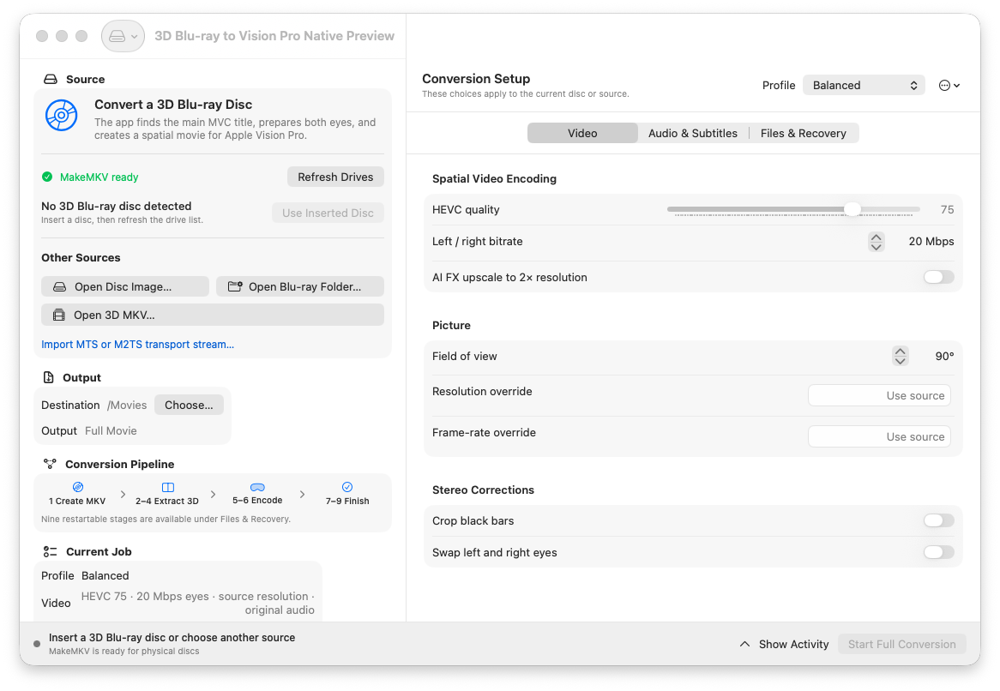
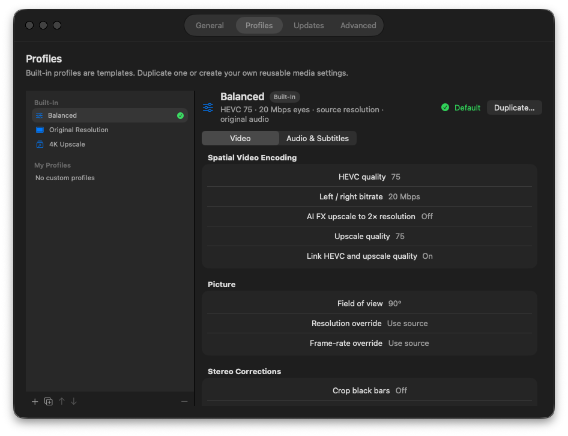

# BD_to_AVP

This repository contains the full Mac converter and the Vision Pro movie player:

| App | Platform | Purpose |
| --- | --- | --- |
| **3D Blu-ray to Vision Pro** | macOS | Convert supported sources into spatial movies and share completed movies with a paired headset. |
| **Shiny 3D Cinema** | visionOS | Choose and play completed movies from Files or a compatible Mac's shared folders. |

Use the [Movie Sharing beta quick start](docs/movie-sharing-beta.md) to install
both apps, share a folder and pair the headset. The [player guide](docs/visionos-player.md)
covers supported formats and developer workflows. The repository, CLI, Xcode targets, bundle IDs and
saved-data paths retain their established `BD_to_AVP`/`BDToAVPPlayer` identities;
they do not need to match the public app names.

## Introduction

The Mac app turns your 3D Blu-ray movies into spatial videos
you can watch on Apple Vision Pro. Give it a supported 3D Blu-ray disc, disc
image, or existing video file, choose where the finished video should go, and
the app prepares a spatial version while preserving the movie's stereoscopic
depth. For physical discs, MakeMKV is still required to read and extract the
title; existing MKV, MTS, and M2TS files do not need that extra step.

Most people should use the default MV-HEVC output, Apple's native spatial-video
format. You can also choose optional 4K AI upscaling and subtitle processing,
but both add time and temporary-storage needs. An experimental AV1 export
targets M5 Apple Vision Pro and custom-player workflows; M2 Apple Vision Pro is
unsupported, and physical M5 stereo qualification remains pending.

Behind the scenes, the app uses FFmpeg, MakeMKV, and a bundled native MVC
decoder helper for video extraction, audio transcoding, and video stream
merging to convert MPEG-4 MVC 3D video to MV-HEVC 3D video. It also injects
360° metadata for spatial media playback.

The default MV-HEVC videos play directly in the Files or
[Screenlit](https://apps.apple.com/us/app/screenlit/id6499478407) app on the AVP.
See the feasibility record before choosing experimental AV1 output.

## Screenshots

[](docs/images/native-ui-acceptance/main-empty-light.png)
[](docs/images/native-ui-acceptance/profiles-dark.png)

## GUI install

For a normal Stable install of `3D Blu-ray to Vision Pro`, download GitHub Latest
from the [releases page]. Open the DMG file and drag the app to your Applications
folder. For prereleases, choose the intended tagged release and update route;
the Beta 3 bootstrap below records the historical transition to the production identity.

The GUI app does not install Homebrew or modify your shell setup. Runtime tools
are bundled into the app where possible. MakeMKV remains an external
requirement for reading Blu-ray discs; install the current macOS version from the
[MakeMKV] website before converting discs.

The production interface starting with the `0.3.0` release line requires Apple
Silicon and macOS 26 or later. Stable `0.2.143` remains the last desktop build
for macOS 14 through 25.

## Direct Blu-ray source support

Unencrypted Blu-ray 3D images and folders convert without MakeMKV and without
an intermediate MKV when the disc's main feature is readable 3D, including
features made of several clips; see
[direct pipeline contracts](docs/direct-pipeline-contracts.md#direct-blu-ray-reads).
Encrypted sources and previews still use MakeMKV.

The production app bundle includes the arm64 `bd3d_reader` and `ssif_probe`
helpers and their private `libbluray` and `libudfread` dylibs under
`Contents/Resources/app/bd_to_avp/{bin,lib}`. It also ships the pinned LGPL
source archives, `RELINKING.md`, copyright notices, and build provenance under
`Contents/Resources/app/bd_to_avp/resources/notices/ssif-probe`. The package
pipeline verifies the committed unsigned checksums before packaging, validates
the copied signed tree's linkage and `@loader_path/../lib` rpath, and runs
each helper's `--version` after signing.

The shipped sources support relinking those LGPL-2.1-or-later libraries. Keep
the replacement libraries ABI-compatible, preserve the private install names,
rebuild for arm64 and macOS 14 or later, and retain the included source and
notice materials with any redistributed app. Issue #718's package boundary is
implemented; MakeMKV conversion and the existing worker protocol remain
unchanged.

### Beta 3 manual bootstrap

Published `v0.3.0-beta.3` was a one-time manual-download seed, not an
update that pre-Beta-3 Stable or RC clients could discover. Those clients
can select only Stable or RC, so they cannot select the Beta route or receive
Beta 3 through Sparkle. Download that exact GitHub Release DMG, drag it into
`/Applications`, and replace the existing production app.

Before replacing the app, quit the production app and every retired Preview
variant, then copy
`~/Library/Application Support/3D Blu-ray to Vision Pro/profiles.json` to a safe
location outside that folder if it exists. Separate bundle identities do not
isolate this profile file: historical Preview and production builds can read and
write the same path. After installing Beta 3, do not edit profiles in a retired
Preview app. The DMG uses the production bundle identifier
`com.shinycomputers.bd-to-avp`, so it replaces/upgrades the production app
rather than creating another app beside it. The retired Beta 1 and Beta 2
Preview apps use separate immutable identities; they remain separate and cannot
Sparkle-update into Beta 3.

After Beta 3 is installed, its Update Route control offers Stable, RC, Beta,
and Alpha. The Beta 3 appcast item is eligible only on Beta and Alpha; Stable
and RC exclude it. Existing Stable or RC selections remain in place until you
explicitly choose another route. Choosing Stable later does not downgrade the
installed Beta 3 app—it waits for a newer eligible Stable build.

Beta 4 (`0.3.0b4`, build `149`) through Beta 8 (`0.3.0b8`, build `153`) and Beta
10 (`0.3.0b10`, build `155`) are published and immutable. Beta 9 (`0.3.0b9`,
build `154`) failed after production signing but before DMG creation and is
permanently burned without publication.
RC 1 (`0.3.0rc1`, build `158`), RC 2 (`0.3.0rc2`, build `159`), and RC 3
(`0.3.0rc3`, build `160`) are published and immutable. RC 3 passed its updater,
accessibility, subtitle-recovery, diagnostics, network-output, cleanup, and
reporter field checks; its targeted qualification retains one native
release-note check whose issue category is explicitly not applicable because
the immutable source notes contain no issue URL. All links present in those
notes passed, so RC 3's signed qualification is complete.

See [Distribution Policy](docs/distribution-policy.md) for the current GUI
release artifact and dependency policy.

See [the release process](docs/release-process.md#versions-builds-and-routes) for Stable, RC, Beta,
and Alpha update eligibility, version mapping, and publication policy.

The [Conversion Setup Beta Test Guide](docs/conversion-setup-beta-test-guide.md)
preserves the earlier source-first interface checklist. Use the current queue
instructions below for the shipped Mac app.

See [Direct Pipeline Contracts](docs/direct-pipeline-contracts.md) for the
automatic minimum-materialization behavior and the durable `--keep-files`
stage contracts.

See [AV1 Stereo Feasibility](docs/av1-stereo-feasibility.md) for the
standards evidence, Apple metadata probe, and boundaries between native
MV-HEVC spatial output and software AV1 stereo export.

## Terminal install or update (power users)

The formula in the custom third-party `cbusillo/tap` repository is the preferred terminal install. It installs the
locked CLI dependencies and FFmpeg while intentionally omitting the PySide6 GUI. Use the signed release DMG for the
desktop app.

### Custom Homebrew tap

```bash
brew tap cbusillo/tap
brew trust cbusillo/tap
brew install bd-to-avp
bd-to-avp --help
```

MakeMKV remains a separate optional install for Blu-ray disc input. Install the current macOS version from the
[MakeMKV] website; existing MKV, MTS, and M2TS sources do not require it.

MakeMKV 2.0 crashes on Blu-ray images and folders without disc encryption, which includes most backups. Until
MakeMKV fixes this, use MakeMKV 1.18.4 with a registration key (MakeMKV posts a free beta key on its forum). When
MakeMKV crashes, the app says so and names this as the likely cause, instead of a generic failure.

The manual PyPI path remains available for power users who prefer to manage their own Python environment and FFmpeg.

## Prerequisites

Ensure the following are installed on your Mac *(if using the terminal/PyPI version)*:

- **Apple Silicon [Mac]**: A Mac with Apple Silicon, such as the M1, M1 Pro, or M1 Max
- **[macOS Sonoma]**: macOS 14 or later.
- **[Python] 3.12**: The supported Python runtime for the PyPI package.
- **[Homebrew]**: The missing package manager for macOS (or Linux).
- **[FFmpeg]**: A complete, cross-platform solution to record, convert, and stream audio and video.
- **[MakeMKV]**: Required only for reading Blu-ray discs and extracting titles.

Current release note: BD_to_AVP still uses MakeMKV for Blu-ray title extraction. By default, existing MKV/MTS/M2TS
sources are reused in place, MVC video streams directly into the bundled native Apple Silicon splitter, and AAC
transcoding avoids an intermediate PCM file. `--keep-files` restores the durable source copy, extracted MVC `.h264`,
and PCM boundaries for inspection, stage resume, and external workflows. Native MVC splitting supports 8-bit Blu-ray
3D MVC sources only. Disc image sources using durable MVC input are probed for up to 30 seconds before splitting; if
the multi-threaded native splitter is unstable for that stream, BD_to_AVP continues in slower single-threaded mode.
The bundled splitter also recovers malformed streams that leave terminal incomplete-frame dependencies instead of
waiting indefinitely for work that cannot complete.

Runtime tool lookup prefers explicit `BD_TO_AVP_<TOOL>_PATH` environment overrides, bundled tools in `bd_to_avp/bin`,
tools already available in `PATH`, and finally the legacy `/opt/homebrew/bin` location. The GUI app uses bundled tools
where available; the terminal/PyPI version still expects power users to install command-line tools themselves.

## Manual terminal/PyPI dependency setup

These steps are for terminal/PyPI users who manage their own command-line tools. GUI users should use the release DMG
and install MakeMKV from the [MakeMKV] website.

```bash
# Install Homebrew
/bin/bash -c "$(curl -fsSL https://raw.githubusercontent.com/Homebrew/install/HEAD/install.sh)"

# Install the external command-line dependencies.
brew install ffmpeg python@3.12

# Install the current macOS MakeMKV build from https://www.makemkv.com/.
# The app bundle is detected automatically from /Applications/MakeMKV.app
# or /Applications/MakeMKV/MakeMKV.app.

# Ensure Python 3.12 is correctly installed then create a virtual environment
python3.12 -m pip install --upgrade pip
python3.12 -m venv ~/.bd_to_avp_venv

# Activate the virtual environment and install BD_to_AVP
source ~/.bd_to_avp_venv/bin/activate
pip install bd_to_avp

# Run the command from the virtual environment
bd-to-avp --help
```

## PyPI GUI extra

The signed release DMG is the supported GUI install. PyPI users who intentionally want the legacy Python GUI can add
the optional dependency and then launch without arguments:

```bash
pip install "bd_to_avp[gui]"
bd-to-avp
```

As long as you provide no arguments, the GUI will open.

The GUI locks configuration load/save actions while a job is active so each
run uses the settings captured at startup. Choosing **Stop Processing**
requests a cooperative stop and keeps the button in a stopping state until the
worker exits.

## Native Mac App Workflow

The signed DMG provides the SwiftUI Mac app described below.

When a disc, ISO, or Blu-ray folder contains multiple MVC titles,
the macOS app can convert the main movie, every detected 3D video, or a custom
selection. Multi-title selections run serially and preserve completed outputs
if a later video needs attention. For source-folder jobs, accepted MKV or subtitle error
continuations resume the failed source and then continue through the original
batch queue. Audio and subtitle language choices are independent. The native
app defaults built-in and new profile options to **Preferred Language Only**
with English selected. Existing version-4 custom profiles retain their stored
choice, while version-1 through version-3 profiles migrate to **All Languages**
to preserve their historical behavior. Preferred-only mode retains every audio
stream whose metadata language matches the selected language; if none match,
the app keeps the source-default audio stream or the first stream and shows a
warning. Titles are not used to guess audio language.

Audio-language filtering can reduce output payload when tracks are omitted,
but this feature does not establish the cause of the output-size report in
issue #202 and does not claim to fix any separately reported media-specific
stall. Those observations remain separate diagnostic work.

The native app uses one persistent queue workspace for composition, review,
execution, and results. Use **Add Sources…**, the queue's **Add** menu, or drag
and drop to append files, folders, disc images, Blu-ray folders, movie folders,
and inserted discs without replacing work already in the queue. For a disc
image, add the ISO file itself. If you choose the folder of a mounted image,
the app reads the image file behind it instead, and refuses when it cannot find
that file, because reading a damaged image through the mounted disc can hang
macOS until restart. An ISO that is smaller than its own filesystem describes
still converts, with a warning that the end of the movie or some extras may be
missing. Select a
waiting video and use **Edit…** to change its Profile and conversion settings,
or **Change…** to choose its destination.

Choose **Configure Source…** from the Add Sources menu when you want to inspect
one source before admitting it. That secondary sheet restores Preview plus main,
all-video, and custom title selection without replacing the main queue
workspace. **Add to Queue**, **Start Queue**, and a reviewed Preview all save
their selected drafts to the durable queue before queue execution begins.

If a source and Profile require a route-quality choice, the item is persisted
immediately as **Needs a Choice** and the available resolution appears in its
detail pane. The queue will not start while any item still needs that choice,
so later videos cannot run ahead of unresolved work. Remembered choices remain
scoped to the matching source and Profile and can be forgotten from the
resolution prompt. Editing a waiting row can also park that row as **Needs a
Choice** instead of losing the unresolved route-quality decision.

Waiting videos can be selected, edited, dragged into a new order, or arranged
from the menu bar's **Queue** menu and the sidebar's **Arrange** menu. The Queue
menu also provides source and detected-disc admission, **Start Queue** or
**Resume Queue**, **Pause After Current**, **Stop Current**, selected-item
**Remove**, and **Undo Remove**. Arrangement commands include **Move Up**
(`⌘⌥↑`), **Move Down** (`⌘⌥↓`), and **Convert Next** (`⌘⌥↩`); **Add Sources…**
uses `⌘O`. Command titles and availability track the same durable queue state
as the sidebar, and Queue actions disable when another app scene such as
Settings is active. Locked rows explain why they cannot move, edit, or be
removed, while active and completed settings remain locked. Work restored after
an app restart never starts automatically; interrupted or stopped videos
require an explicit **Resume Queue**, **Restart Safely**, or recovery choice.
**Pause After Current** lets the active video finish without starting another,
while **Stop Current** cancels only the active video and leaves pending work
waiting for an explicit resume. Runtime failures and recovery decisions remain
parked according to their existing queue policy.

The sidebar includes a compact **Results** strip once durable outcomes exist,
with count buttons for completed, failed, and needs-action items. Needs action
groups choices, interrupted work, and recovery decisions separately from failed
items; selecting a count jumps to the first matching queued item, and
**Clear Completed** sits beside the counts. Restored work, run-time and pause
notices, results, and the storage forecast share one block above the list; the
forecast lists only destinations with at least one estimated video. In the
sidebar, **Pause After Current** and **Stop Current** take the place of **Start
Queue** while a video converts.

Queue notifications are optional and default off in Settings. The app can notify
when a queue run finishes and/or when a queued item first needs attention during
that run. macOS notification text is count-only: source names, file paths,
destinations, technical details, and failure text stay inside the app.

**Settings → Watch Folders** adds movies to the queue as they arrive in chosen
folders. Each folder has its own profile, an **Include subfolders** option, and a
**New items** choice: **Hold for review** (the default) or **Start
automatically**. A file is admitted only after its size and modification time
stop changing and no app running as you still has it open for writing, through
the same duplicate protection as manual adds. A MakeMKV title also waits until
MakeMKV finishes it, so a rip that pauses on a damaged disc, or stops partway,
is never admitted half-written; the folder lists such files as **Still being
written**. Point a watch folder at MakeMKV's output folder to hand rips to the
queue. A file removed from the queue is not admitted again unless **Forget Seen
Files** is used. Held items show a **Ready for Review** banner grouped by folder, with
**Review**, **Start All**, and dismiss; each held row offers **Release** and
**Remove**, and the item detail shows its watch folder and arrival times. When
the "needs attention" notification is on, new held items produce one count-only
notification. **Start automatically** and **Start All** start an idle queue with
only those items, join a running queue, and never override a pause, a requested
pause, a scheduled window, the queue's run times, or other active work. Folders are watched while the
app is open; at launch the app checks for anything that arrived while it was
closed. A folder on a disconnected drive shows **Drive offline** and resumes when
the drive mounts again.

To keep a 3D disc as a file instead of converting it, choose **Output files →
Just the 3D disc rip, not converted** in Advanced Settings, or save it in a
profile and give that profile to a watch folder. Your copy of MakeMKV saves the
movie as one MKV with both eyes and every audio and subtitle track, named after
the movie, in the destination folder. Point the destination at a shared folder
and Shiny 3D Cinema plays it from **Locations**. The app checks that the rip
kept the second eye and reports a 2D-only rip as a failure instead of adding it.
The app never decrypts anything itself; only MakeMKV reads disc encryption.

The queue also shows a coarse storage forecast grouped by destination. Each
forecast separates estimated output, peak temporary/working space, retained
intermediates, a visible safety margin, and total peak space. Forecasts use
known source duration and route information when available; content-dependent
or artifact-based routes remain explicitly unestimated rather than turning an
assumption into a capacity block. The safety margin is 10% of peak working
space, rounded up to whole GiB and clamped between 2 GiB and 20 GiB.

Immediately before each queued item starts inspecting or converting, the app
rechecks that its destination exists, is a writable directory, and has enough
confirmed free space for the coarse total peak estimate. Unknown or conflicting
capacity readings are advisory and do not block an item. A disconnected or
read-only destination parks only that item with a retryable reconnect/check-
writable message; known insufficient space parks the item with required and
available coarse sizes and pauses the remaining queue. Reconnect the volume or
free space and retry the parked item, or change its destination and resume the
queue. The queue-level forecast covers remaining not-yet-active work; held
route-quality and recovery choices are listed as unestimated until resolved.

Use **Start Later…** to arm one editable, cancellable off-peak window for the
queue. The app must remain open: it does not schedule a system wake and does
not keep the Mac awake merely because a window is armed. If the Mac wakes while
the window is still open, the queue starts late; reopening the app after the
start time or evaluating after the end marks the window missed and never starts
it automatically. A video already running may finish after the end, but no new
video starts outside the window. Sources are rechecked at launch time, and
missing removable media or the wrong physical disc is parked while unrelated
available work continues.

**Settings → Schedule** sets when the app may start queued videos on its own.
Every rule is off until you turn it on. **Run times** are weekly periods, such as
every night 1:00–7:00 AM or weekdays only; a run time whose end is at or before
its start continues into the next morning, and one whose start and end match
lasts 24 hours. Settings shows when the next run time starts. While a run time
is open and the queue is idle, the app starts the waiting videos; when it ends,
the current video finishes and no new video starts until the next run time. The
conditions **Wait while on battery power** and **Wait while the Mac is running
hot** (serious or critical thermal pressure) work the same way: they never
interrupt a converting video, they only keep new ones from starting, and an
automatic run they stopped resumes when power returns or the Mac cools down.
The queue shows what it is waiting for; its **Queue Activity** (in the queue
options menu, or from the waiting notice) lists what it did on its own. Those
decisions are kept with the watch-folder settings in `queue.automation.json`.
These rules never override a pause or a pending **Start Later** window, which
runs at its own time (it still waits for power or for the Mac to cool down, and
is reported missed if its window ends first). Interrupted or stopped videos are
never restarted on their own. Opening the app or waking the Mac inside a run
time starts eligible waiting work; a run time missed while the Mac slept or the
app was closed is not made up later. **Start Queue** always starts right away,
whatever the rules say. The app must remain open, and run times do not wake the
Mac or keep it awake.

**When the queue finishes** (also in **Settings → Schedule**) can put the Mac to
**Sleep** or **Shut Down** after a run; it is **Do Nothing** until you choose
otherwise. It acts only when a run ends with every video in the queue finished:
nothing waiting, held for review, stopped, failed, or needing a choice, and no
**Start Later** window pending. It is also skipped when someone used the
keyboard, mouse, or trackpad in the last 5 minutes, or while a preview, another
conversion, Movie Sharing, or a relay session is active. Otherwise a 60-second
countdown appears with **Cancel**; any input, new queue work, or the Mac
sleeping during the countdown cancels it. Sleep uses macOS power management.
Shut Down asks macOS to shut down the way the Apple menu does, so apps with
unsaved changes can still stop it; macOS asks once for permission when you
choose it, and if permission is missing the Mac stays on. Every skip,
countdown, cancel, and request is listed in **Queue Activity**.

## Terminal Usage

Navigate to the tool's directory in your terminal and execute the command with the required and optional parameters:

### Command Syntax

```bash
bd-to-avp --source <source> [options]
bd-to-avp --source-folder <source-folder> [options]
```

### Parameters

- `--source`: Source for a single disc (`disc:N`), MKV file path, or ISO image path. Choose either this option or
  `--source-folder`; the CLI rejects both together.
- `--source-folder`: Source folder path. Recursively scans for disc images, MTS/M2TS and MKV files.
  Missing or non-directory paths and scans without supported files return an error.
  Folder conversions report each failed source, attempt the remaining files and exit
  with a failure status if any conversion failed. Existing outputs are reported as
  skipped unless `--overwrite` is enabled.
- `--fx-upscale`: Upscale video to 4K resolution using fx-upscale (disabled by default).
- `--remove-original`: Remove the original source after processing completes successfully.
- `--overwrite`: Overwrite existing output file.
- `--keep-files`: Use durable stage boundaries and keep retained intermediates. This affects retention only; it does
  not change the selected audio policy. An explicit `--remove-original` still removes the selected source after a
  successful conversion.
- `--output-root-folder`: Output folder path. Defaults to `~/Movies`.
- `--audio-mode`: Audio handling mode: `automatic`, `convert_aac`, or `pcm` (default: `automatic`). Automatic copies
  qualified AAC audio to an owned M4A, and converts the whole selected set to AAC if any selected stream is unqualified.
  Sources without audio produce a video-only movie; the app does not synthesize a silent track.
- `--transcode-audio`: Legacy alias for `--audio-mode convert_aac`.
- `--audio-bitrate`: Audio bitrate for AAC conversion in kb/s do not include unit (default: "384").
- `--audio-preferred-language`: Keep every audio track matching this language metadata. Accepts ISO 639 alpha-2,
  alpha-3/B, and alpha-3/T codes. Omit it to keep all audio languages.
- `--left-right-bitrate`: Bitrate for left and right views in Mb/s do not include unit (default: "20").
- `--mv-hevc-quality`: Quality factor for MV-HEVC encoding (default: "75").
- `--fov`: Horizontal field of view for MV-HEVC (default: "90").
- `--frame_rate`: Video frame rate (auto-detected if not provided).
- `--resolution`: Video resolution (auto-detected if not provided).
- `--swap-eyes`: Swap left and right views (disabled by default).
- `--start-stage`: Start processing at a specific stage.
- `--output-commands`: Output commands used to console.
- `--software-encoder`: Use software encoder for MV-HEVC encoding (disabled by default).
- `--skip-subtitles`: Skip subtitle extraction (disabled by default).
- `--continue-on-error`: Continue processing after an error (disabled by default).
- `--language-code`: Preferred subtitle language (default: `eng`). Accepts ISO 639 alpha-2, alpha-3/B, and alpha-3/T
  codes. Subtitle and audio language choices are independent.
- `--remove-extra-languages`: Remove subtitle languages other than `--language-code` (disabled by default).
- `--no-keep-awake`: Allow the system to sleep during processing. Without this flag, processing keeps the Mac awake.
- `--version`: Show the version number and exit.

#### Stage Names

- CREATE_MKV
- EXTRACT_MVC_AND_AUDIO
- EXTRACT_SUBTITLES
- CREATE_LEFT_RIGHT_FILES
- COMBINE_TO_MV_HEVC
- UPSCALE_VIDEO
- TRANSCODE_AUDIO (Prepare Audio)
- CREATE_FINAL_FILE
- MOVE_FILES

### Examples

Process a Blu-ray disc:

```bash
bd-to-avp --source disc:0 --output-root-folder /path/to/output
```

Process an ISO image:

```bash
bd-to-avp --source /path/to/movie.iso --output-root-folder /path/to/output
```

Process an MKV file:

```bash
bd-to-avp --source /path/to/movie.mkv --output-root-folder /path/to/output --transcode-audio
```

## Upscale Quality

For most users, the default values of 75 HEVC Quality and 75 Upscale Quality provides a good tradeoff of preserving all
the details of the original film, the extra details generated by the upscaler, while also keeping the size of the
resulting video manageable.

If you would like to change the default quality, here are some recommended alternative settings sorted by final output
size, with some notes about the quality of the results.

| HEVC Quality | Upscale Quality | Min Processing Space Needed | Final Size | Notes                                                                                                       |
|--------------|-----------------|-----------------------------|------------|-------------------------------------------------------------------------------------------------------------|
| 85           | 85              | ~ 225 GB                    | ~ 95 GB    | These settings are arguably "too" high. Only for those obsessed with maintaining the best possible quality. |
| 85           | 50              | ~ 130 GB                    | ~ 62 GB    | A reasonable choice for "Best Quality" encoding.                                                            |
| 75           | 75              | ~ 100 GB                    | ~ 47 GB    | The default setting.                                                                                        |
| 75           | 50              | ~ 75 GB                     | ~ 37 GB    | Provides a good trade-off for minimizing storage space while retaining quality throughout the process.      |
| 65           | 65              | ~ 75 GB                     | ~ 32 GB    | Compression artifacting is very visible in dark scenes or on fast-moving objects, but is otherwise okay.    |

HEVC Quality values below 65 are not recommended when upscaling. At that quality level, you are essentially upscaling
compression artifacts. Keeping the video in 1080p and increasing the HEVC Quality will result in a better viewing
experience.

## Note on Blu-ray drives

If your BD drive does not seem to be compatible with your M-series Mac, it's possible that the error is related to the
region code, which BDs handle differently than DVDs.

### Solution

- Connect your BD drive to your Mac via USB. Using a dongle often yields better results than a direct connection.
- Insert a DVD (not a Blu-ray) into the drive and open the DVD Player.
- If prompted, select a region code for the DVD.
- Eject the DVD and insert a Blu-ray disc. Your Mac should now recognize the Blu-ray discs.

This method has been effective in resolving compatibility issues.

## Contribution

For subtitle integration checks and the recorded hosted Vision limitation, see
[real PGS subtitle tests](docs/pgs-ocr-testing.md).

Contribute to the project by submitting pull requests or opening issues for bugs and feature requests.

For JetBrains inspection, `.github/github.json` configures the maintained
`jetbrains-inspection` helper's Python preparation. Run its `open-worktree` or
`agent-inspect` command in the exact checkout; preparation uses the locked uv
environment and generates ignored module, interpreter and module-registry files.
Shared inspection, mypy, Ruff and VCS settings remain tracked. Updating a checkout
removes its previously tracked module registry; run preparation to regenerate it.
Preparation is separate from inspection: an UNKNOWN result still means the IDE
has not established a clean assessment.

The Director's [overall direction](https://github.com/cbusillo/direction/blob/HEAD/DIRECTION.md)
applies to this repository; it has no separate DIRECTION.md. Agents start with
[AGENTS.md](AGENTS.md), which points to the maintained execution workflow and
records repository-specific release and validation requirements. GitHub issues
hold the work plan.

### Local tests and CI

Follow [AGENTS.md's test selection](AGENTS.md#tests) and the commands in
`.github/github.json`. The CI workflow owns fixture setup and the hosted Vision
exception. [Native MVC integration](docs/native-mvc-integration.md) documents
the external-fixture lane; the PGS guide above covers actual OCR qualification.

### TLS lint

Run `qualityGate.lint.default` from `.github/github.json` before a PR. The
existing Ruff gate includes the five TLS rules, and CI also runs the catalog's
immutable reviewed checker for hand-built verification disabling. The latter
uses Python 3.14 only as a source parser; the app's Python requirement is
unchanged. Update its pin in the runnable lint command in `.github/github.json` after
reviewing the catalog change. CI reads that same command.

A justified exception needs an `insecure-tls:` comment with its plain reason
at the choke point, plus a permanent decision link when applicable. Add a
targeted Ruff `noqa` only if its library rule also reports that same call.
Bare ignores do not satisfy the shared check. These lint commands do not
change app settings, a release, signing, or an installed build.

## Acknowledgements

Big thanks to:

- [sturmen][sturmen] on the Doom9 forums, for [an encoding guide][sturmen-guide] using `FRIM Decoder` as well as
  creating
  the [spatial-media-kit-tool]
- [Vargol][vargol] on GitHub, for making
  the [JM reference software][jm-reference] [build properly on macOS][vargol-tools] as well as
  an [example script][vargol-guide] that was a useful reference
- [steverice][steverice] for [h264-tools][ldecod]
- Thibault Raffaillac, Celticom/TVLabs, and Jens Duttke for [edge264-mvc][edge264-mvc], used by the bundled native MVC
  splitter. The BSD license notice is included in `bd_to_avp/resources/notices/edge264-mvc-LICENSE_BSD.txt`. The
  pinned source revision directly supports Annex B MVC input from stdin and FIFOs, nonzero failure exits, bounded
  no-progress recovery, terminal incomplete-frame recovery, and skipping a corrupt right-eye slice with the damaged
  frame filled in from the left eye. `scripts/build_edge264_macos.py` reproduces the
  unsigned binary with the pinned release Xcode, SDK, and baseline arm64 architecture flags. App packaging re-signs
  that Mach-O as part of the containing application signature. `bd_to_avp/resources/notices/edge264-mvc-build.json`
  is the source of truth for the source revision, build toolchain, deployment target, linkage, and reproducible
  unsigned binary checksum.
  To move the pin, run the **Update edge264 Pin** workflow (or, with the pinned Xcode installed,
  `uv run python scripts/build_edge264_macos.py --update latest`): it builds the requested tag or commit, runs
  upstream's checks, and writes the binary, revision and checksum together. The builder accepts upstream's
  `edge264mvc_test` executable (or `edge264_test` from older revisions) and packages it as `edge264_test`.
  Damaged-source warnings accept both revisions' diagnostic prefixes.
  The workflow pushes the result as the
  `automation/update-edge264` branch; open the pull request from it, and CI rebuilds the decoder byte for byte. That CI rebuild compiles the pinned binary
  without rerunning upstream's checks; the matching checksum ties it to the build that passed them. A weekly watch opens an issue when upstream tags a release newer than the pin.
  Shiny 3D Cinema decodes Blu-ray 3D on Vision Pro with the same pinned revision, linked as the separate dynamic
  framework `macos/Vendor/Edge264MVC.xcframework`; `scripts/build_edge264_visionos.py` rebuilds it from that pin.
  After moving the pin, rebuild the framework too.

[MakeMKV]: https://www.makemkv.com/

[FFmpeg]: https://ffmpeg.org/

[jm-reference]: https://iphome.hhi.de/suehring/

[ldecod]: https://github.com/steverice/h264-tools

[spatial-media-kit-tool]: https://github.com/sturmen/SpatialMediaKit

[MP4Box]: https://github.com/gpac/gpac/wiki/MP4Box

[sturmen]: https://forum.doom9.org/member.php?u=224594

[sturmen-guide]: https://forum.doom9.org/showthread.php?p=1996846#post1996846

[vargol]: https://github.com/Vargol

[vargol-tools]: https://github.com/Vargol/h264-tools

[vargol-guide]: https://github.com/Vargol/h264-tools/wiki/Conversion-script-for-MVC-3D-blu-ray-extracted-by--MakeMKV

[steverice]: https://github.com/steverice

[h264-tools]: https://github.com/steverice/h264-tools

[edge264-mvc]: https://github.com/jens-duttke/edge264-mvc

[Homebrew]: https://brew.sh/

[Python]: https://www.python.org/

[Mac]: https://www.apple.com/mac/

[macOS Sonoma]:https://apps.apple.com/us/app/macos-sonoma/id6450717509?mt=12

[releases page]: https://github.com/cbusillo/BD_to_AVP/releases
